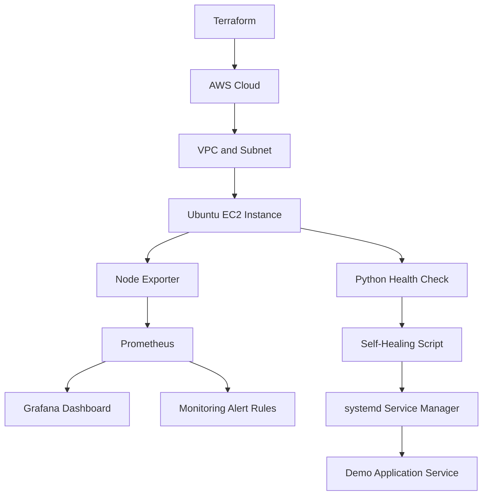
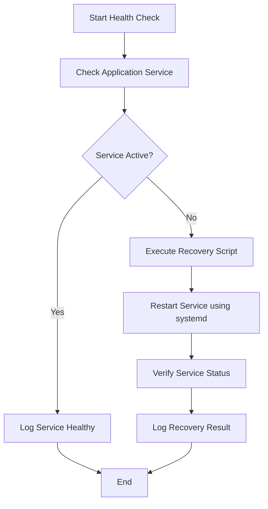

# CloudOps – Self-Healing Infrastructure Monitoring

A hands-on Cloud and DevOps project that combines **AWS infrastructure provisioning, Linux system monitoring, metrics visualization, and automated service recovery**.

The goal of this project is to monitor an AWS EC2 instance, identify infrastructure or service issues, and automatically recover an inactive application service using Python and Linux system administration tools.

---

## 📌 Project Overview

CloudOps Self-Healing Infrastructure Monitoring demonstrates how cloud infrastructure can be monitored and basic service failures can be handled automatically.

The project uses **Terraform** to provision AWS infrastructure, **Prometheus and Node Exporter** to collect system metrics, and **Grafana** to visualize infrastructure performance.

Python-based health-check and recovery scripts check the application service and help restart it when it becomes inactive. Linux `systemd` is used to manage the service.

### Key Objectives

- Provision AWS infrastructure using Terraform.
- Deploy and configure an Ubuntu EC2 instance.
- Monitor CPU, memory, and disk utilization.
- Collect infrastructure metrics using Prometheus and Node Exporter.
- Visualize monitoring data through Grafana dashboards.
- Configure monitoring alerts for infrastructure usage.
- Implement Python scripts for service health checks and recovery.
- Understand practical CloudOps and DevOps monitoring workflows.

---

## 🏗️ Architecture

### High-Level Architecture



### Architecture Explanation

1. **Terraform:** Provisions the required AWS infrastructure.
2. **AWS EC2:** Hosts the Ubuntu Linux environment and monitoring components.
3. **Node Exporter:** Exposes system-level metrics such as CPU, memory, and disk usage.
4. **Prometheus:** Scrapes and stores metrics collected from Node Exporter.
5. **Grafana:** Uses Prometheus as a data source to visualize infrastructure metrics.
6. **Alert Rules:** Evaluate configured infrastructure thresholds.
7. **Python Health Check:** Checks the status of the demo application service.
8. **Self-Healing Script:** Performs recovery by restarting an inactive service.
9. **systemd:** Manages the Linux service lifecycle.

---

## ⚙️ Key Implementations

### 1. AWS Infrastructure Provisioning

- Created AWS infrastructure using Terraform.
- Configured a Virtual Private Cloud (VPC).
- Created a public subnet.
- Configured an Internet Gateway.
- Created route tables and route associations.
- Configured Security Groups.
- Launched an Ubuntu EC2 instance.

### 2. Infrastructure Monitoring

- Installed and configured Prometheus.
- Installed Node Exporter to expose Linux system metrics.
- Configured Prometheus to scrape Node Exporter metrics.
- Monitored CPU, memory, and disk utilization.
- Verified metric collection through the Prometheus interface.

### 3. Grafana Visualization

- Configured Grafana with Prometheus as its data source.
- Created dashboards to visualize infrastructure performance.
- Displayed CPU, memory, and disk utilization.
- Configured a high CPU usage alert rule.

### 4. Python-Based Health Checks

- Developed a Python health-check script.
- Checked the availability of the demo application service.
- Added logging to record health-check and recovery activities.
- Used Linux service-management commands to inspect service status.

### 5. Self-Healing Mechanism

- Developed a Python recovery script.
- Detected when the demo service became inactive.
- Restarted the service using `systemd`.
- Verified that the service returned to an active state.
- Tested the recovery workflow by manually stopping the demo service.

---

## 🛠️ Technology Stack

| Category | Technologies |
|---|---|
| Cloud Platform | AWS |
| Infrastructure | EC2, VPC, Subnet, Internet Gateway, Security Groups |
| Infrastructure as Code | Terraform |
| Operating System | Ubuntu Linux |
| Monitoring | Prometheus, Node Exporter |
| Visualization | Grafana |
| Scripting | Python, Bash |
| Service Management | systemd |
| Scheduling | Cron |
| Version Control | Git, GitHub |

---

## 📊 Monitoring Workflow

The monitoring workflow follows these steps:

1. Node Exporter collects system-level metrics from the EC2 instance.
2. Prometheus periodically scrapes the metrics exposed by Node Exporter.
3. Prometheus stores the collected metrics.
4. Grafana queries Prometheus and displays the metrics in dashboards.
5. Configured alert rules evaluate infrastructure resource usage.

### Metrics Monitored

- **CPU Utilization:** Tracks processor usage.
- **Memory Utilization:** Tracks RAM consumption.
- **Disk Utilization:** Tracks available and used disk space.

---

## 🔄 Self-Healing Workflow

The self-healing component demonstrates basic automated service recovery.



### Recovery Test

To test the recovery mechanism:

1. Stop the demo application service.
2. Execute the health-check and recovery workflow.
3. The script identifies that the service is inactive.
4. The recovery script restarts the service.
5. Verify the service status using `systemctl`.

Example Linux command to verify a service:

```bash
sudo systemctl status <service-name>
```

<escape>Replace </escape>`<service-name>`<escape> with the actual service name configured on your EC2 instance.</escape>

---

## 📸 Project Screenshots


## 🚀 Getting Started

### Prerequisites

Make sure you have the following tools:

- AWS Account
- AWS CLI
- Terraform
- Ubuntu Linux environment
- Python 3
- Git

### Step 1: Clone the Repository

```bash
git clone https://github.com/Suraj-dot-wq/CloudOps-Self-Healing-Monitoring.git

cd CloudOps-Self-Healing-Monitoring
```

### Step 2: Configure AWS Credentials

```bash
aws configure
```

Provide your AWS Access Key, Secret Access Key, default region, and output format when prompted.

### Step 3: Initialize Terraform

Navigate to the directory containing your Terraform configuration files:

```bash
terraform init
```

### Step 4: Validate and Review Infrastructure

```bash
terraform validate

terraform plan
```

### Step 5: Deploy Infrastructure

```bash
terraform apply
```

Review the proposed changes before confirming deployment.

### Step 6: Run Python Scripts

After connecting to the configured Ubuntu EC2 instance, navigate to the project directory and execute the health-check or recovery scripts using their configured paths.

Example:

```bash
python3 scripts/health_check.py

python3 scripts/self_heal.py
```

Make sure the service name and required permissions are configured correctly before executing the recovery script.

---

## 📁 Project Structure

The following is a logical representation of the project components. Adjust directory names to match the actual repository layout.

```text
CloudOps-Self-Healing-Monitoring/
│
├── terraform/
│   └── Terraform configuration files
│
├── scripts/
│   ├── demo_service.py
│   ├── health_check.py
│   └── self_heal.py
│
├── monitoring/
│   └── Prometheus configuration files
│
├── logs/
│   └── Application and recovery logs
│
└── README.md
```

---

## 🔐 Security Considerations

- Avoid committing AWS access keys or secret credentials.
- Restrict EC2 Security Group access to required ports and trusted IP addresses.
- Follow the principle of least privilege for AWS IAM permissions.
- Protect monitoring interfaces from unauthorized public access.
- Grant only the required Linux permissions to recovery scripts.
- Review infrastructure changes before applying Terraform configurations.

---

## 📚 Key Learnings

Through this project, I gained practical experience in:

- Provisioning cloud infrastructure using Terraform.
- Working with AWS EC2, VPC, subnets, and Security Groups.
- Managing Ubuntu Linux servers.
- Understanding Prometheus metric collection.
- Creating Grafana monitoring dashboards.
- Monitoring CPU, memory, and disk utilization.
- Writing Python automation scripts.
- Managing Linux services using systemd.
- Implementing basic self-healing and service recovery.
- Troubleshooting cloud infrastructure and application issues.

---

## 🔮 Future Improvements

- Integrate Alertmanager for alert routing and notifications.
- Configure email notifications for critical infrastructure alerts.
- Implement retry limits and improved failure handling.
- Add more monitoring rules for infrastructure health.
- Integrate CI/CD automation for deployment.
- Extend self-healing capabilities to additional services.
- Improve recovery logging and incident tracking.

---

## 👨‍💻 Author

**Suraj Ghadage**

B.E. Computer Science and Design

Interested in Cloud Engineering, DevOps, Cloud Operations, and Infrastructure Automation.

- GitHub: https://github.com/Suraj-dot-wq
- Project Repository: https://github.com/Suraj-dot-wq/CloudOps-Self-Healing-Monitoring

---

⭐ If you find this project useful, feel free to explore the repository and share your feedback.
